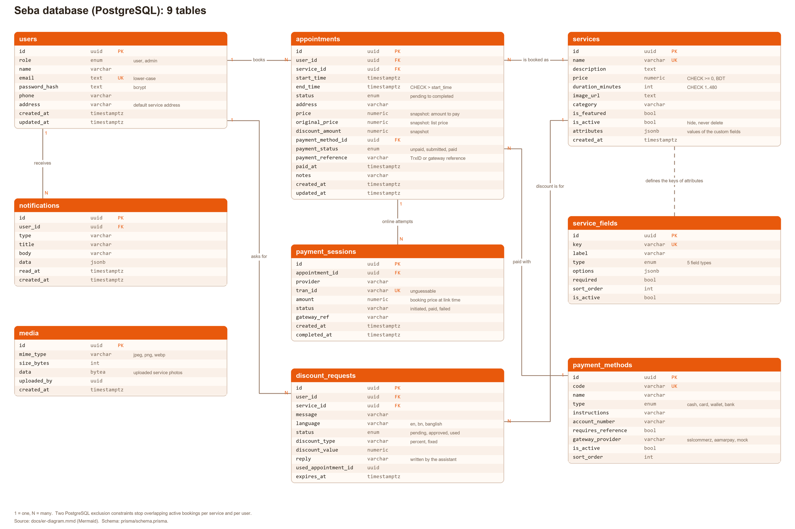
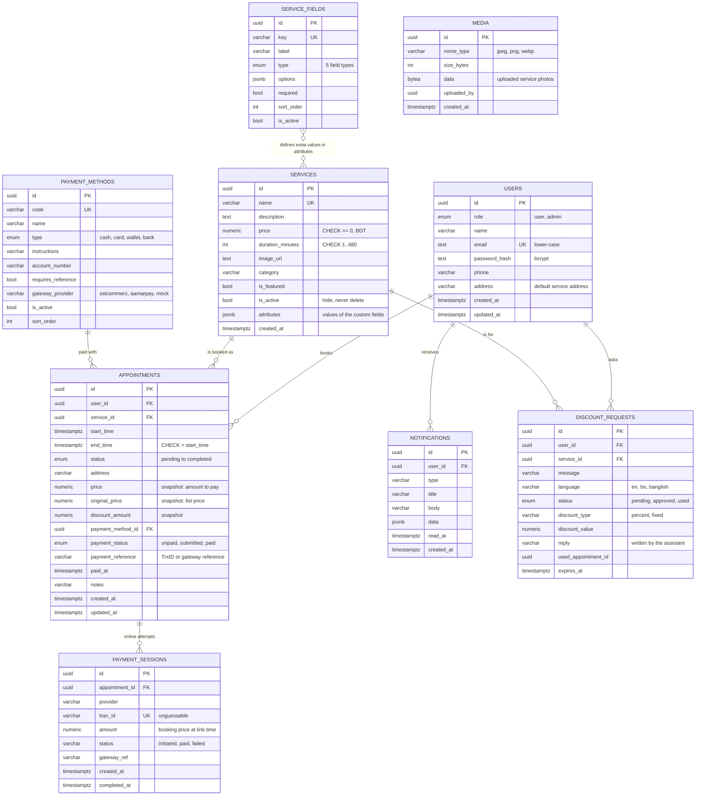

# Seba (সেবা) Backend

REST API for **Seba**, a service booking and management app: customers browse services, book appointments, manage their bookings, and ask an AI assistant (English, Bangla or Banglish) for recommendations.

- **Roles:** customer and admin accounts, with admin tools for services (dynamic form), payments, discounts, bookings, a dashboard and sales reports
- **Currency:** all prices are in **BDT** (Bangladeshi taka, ৳)
- **Stack:** Node.js 24, Express 5, PostgreSQL 16, Prisma 7, JWT, Zod, Gemini
- **Interactive API docs (Swagger UI):** `http://localhost:3000/api/docs` (spec: [`docs/openapi.yaml`](docs/openapi.yaml))
- **Live API (Render + Neon):** https://seba-api-0062.onrender.com (Swagger: https://seba-api-0062.onrender.com/api/docs). Free tier: the first request after idle can take 30-60 s.
- **Flutter app:** see the `service-booking-app` repository

## See it in action

The Flutter app uses this API for everything below. More screenshots are in the [app README](https://github.com/saad125862/service-booking-app#screenshots).

<table>
<tr>
<td align="center" valign="top"><br><sub>Pay online for the exact amount</sub></td>
<td align="center" valign="top"><br><sub>AI discount, approved by an admin</sub></td>
<td align="center" valign="top"><br><sub>AI sends the payment link</sub></td>
<td align="center" valign="top"><br><sub>Admin verifies manual payments</sub></td>
<td align="center" valign="top"><br><sub>Sales reports</sub></td>
</tr>
</table>

## Quick start (Docker)

Requires Docker Desktop. Nothing else needs to be installed.

```bash
cp .env.example .env          # then edit values if you like (see below)
docker compose up -d --build  # starts PostgreSQL + the API
```

On start the API container applies the database migrations, seeds demo data, and runs on **http://localhost:3000**.

| | |
|---|---|
| Health check | http://localhost:3000/api/v1/health |
| Swagger UI | http://localhost:3000/api/docs |
| Demo customer | `demo@example.com` / `Demo@1234` |
| Demo admin | `admin@example.com` / `Admin@1234` (role `admin`; public sign-up only ever creates customers) |
| Admin key (local) | `dev-admin-key-change-me` (header `X-Admin-Key`) |

Code changes: Docker Desktop on Windows doesn't forward file-change events, so run `docker compose restart api` after editing `src/`. After changing `package.json` or the Prisma schema, run `docker compose up -d --build api`.

Reset the database completely: `docker compose down -v && docker compose up -d --build`.

## Configuration

All settings are environment variables, validated at startup (the app refuses to boot with a bad config). See [`.env.example`](.env.example).

| Variable | Purpose |
|---|---|
| `DATABASE_URL` / `DATABASE_SSL` | PostgreSQL connection. Set `DATABASE_SSL=true` for Neon. |
| `JWT_SECRET` | Signing secret, at least 32 characters. |
| `JWT_EXPIRES_IN` | Token lifetime (default `7d`). |
| `ADMIN_API_KEY` | Key for the admin status endpoint (at least 16 characters). |
| `BUSINESS_TZ` | IANA time zone for working hours and slot labels (default `UTC`; this project uses `Asia/Dhaka`, Bangladesh time, UTC+6). |
| `CORS_ORIGINS` | Comma-separated allowed origins, or `*`. |
| `GEMINI_API_KEY` | Google AI Studio key. **Stays on the server only.** Empty disables the assistant. |
| `GEMINI_MODEL`, `GEMINI_FALLBACK_MODEL` | Primary and fallback model (fallback is tried once on overload, rate limit or timeout). |
| `PUBLIC_API_URL` | This API's public URL. Payment gateways send the customer's browser back to it. |
| `SSLCOMMERZ_STORE_ID`, `SSLCOMMERZ_STORE_PASSWORD`, `SSLCOMMERZ_SANDBOX` | SSLCommerz (cards, bKash, Nagad, Rocket). Optional; the option is offered only when set. |
| `AAMARPAY_STORE_ID`, `AAMARPAY_SIGNATURE_KEY`, `AAMARPAY_SANDBOX` | aamarPay. Optional, same rule. |
| `GATEWAY_MOCK_ENABLED` | Built-in pretend checkout for demos and tests (default on outside production). |

## Tests

Integration tests run against the local PostgreSQL (they create and delete their own `test-*` users).

```bash
docker compose up -d db
npm install
npm test
```

They cover auth, profile, catalog filters, slot generation, booking conflicts (including a concurrent double-booking race), cancel rules, ownership checks, admin transitions and AI endpoint validation. Gemini is never called in tests.

## Database



Nine tables: `users`, `services`, `appointments`, `payment_methods`, `payment_sessions`, `discount_requests`, `notifications`, `service_fields` and `media`. Bookings keep a **price snapshot** (list price, discount, amount to pay) so later price edits never rewrite past sales. The diagram's source is [`docs/er-diagram.mmd`](docs/er-diagram.mmd) (Mermaid, rendered below by GitHub too).

<details>
<summary>Mermaid source</summary>



</details>

Set-up: `docker compose up -d --build` starts PostgreSQL and the API, applies the migrations and seeds demo data (see [Quick start](#quick-start-docker)). Start over with `docker compose down -v && docker compose up -d --build`.

Schema: [`prisma/schema.prisma`](prisma/schema.prisma). Migration: [`prisma/migrations/`](prisma/migrations/). Prisma cannot express the CHECK constraints or the exclusion constraints below, so they are hand-written SQL at the end of the init migration.

### Preventing conflicting bookings

Two PostgreSQL exclusion constraints (using `btree_gist`) are the source of truth:

- `appointments_no_service_overlap`: no two **active** (`pending` / `confirmed`) appointments for the same service may overlap in time.
- `appointments_no_user_overlap`: one user cannot hold two overlapping active appointments.

Cancelled and completed appointments are ignored, so cancelling frees the slot. Because the database enforces this, simultaneous requests cannot double-book: one succeeds (`201`) and the other gets `409 SLOT_UNAVAILABLE`. The availability endpoint is advisory only, for the UI.

### Booking rules

Configurable in [`src/config/constants.js`](src/config/constants.js): working hours 09:00-17:00 in `BUSINESS_TZ`, 30-minute slot grid, a slot must end before closing, minimum 60 minutes' notice, up to 60 days ahead. A service has one provider (capacity 1).

Statuses: `pending` (new) → `confirmed` → `completed`, or `cancelled`. Customers can cancel only `pending` bookings. Admins confirm, complete or cancel bookings in the app's admin screens; the same transition is available to scripts with the ops key:

```bash
curl -X PATCH http://localhost:3000/api/v1/admin/appointments/<id>/status \
  -H "X-Admin-Key: dev-admin-key-change-me" -H "Content-Type: application/json" \
  -d '{"status":"confirmed"}'
```

A background job also marks confirmed appointments as `completed` once their end time has passed.

## AI assistant

`POST /api/v1/ai/chat` (authenticated): the assistant answers questions about the services and recommends up to three, returning their ids so the app can show tappable cards.

- **Languages:** it detects whether the latest message is **English**, **Bangla** (বাংলা script) or **Banglish** (Bangla in Latin letters) and replies in the same one. The response includes `language` (`en`, `bn`, `banglish`).
- **Grounded:** the current service catalog is injected into every request, so it cannot invent services or prices. Returned ids are validated against the database.
- **Safe:** the API key lives only on the server. Input is limited (500 characters, 10 history messages), requests are rate-limited per user (10/min), off-topic and prompt-injection attempts are declined.
- **Resilient:** 20 s timeout, one retry on a fallback model, and a clear `503 AI_UNAVAILABLE` if both fail.

## Admin, payments, discounts and notifications

Two kinds of accounts: **customers** and **admins** (`role` on the user; public sign-up only ever creates customers, the demo admin is seeded). Everything under `/api/v1/admin` needs an admin's JWT; the role is read from the database on every request. Full details and examples are in Swagger.

| Area | What it does |
|---|---|
| **Services (dynamic form)** | Admins add, edit and hide services. The form is dynamic: admins can define **custom fields** (text, long text, number, yes/no, dropdown; required or optional) with `/admin/service-fields`, and each service stores values for them in `attributes`. The API validates the values against the field definitions; customers see the filled values on the service page. |
| **Photo uploads** | Admins upload a service photo with `POST /admin/uploads/image` (raw JPG, PNG or WebP bytes, up to 5 MB). The real type is checked from the file's first bytes, the image is stored in PostgreSQL (so it survives redeploys on hosts with a temporary disk) and served publicly from `/media/{id}` with long cache headers. The returned `url` is used as the service's `imageUrl`. |
| **Payment options** | Admins manage the payment methods customers can choose when booking: cash, card, bKash, Nagad, bank and so on (`/admin/payment-methods`). Wallet-style methods ask for the customer's transaction ID, and an admin verifies it (`PATCH /admin/appointments/{id}/payment`). Manual methods move no money through this server. |
| **Online payments (SSLCommerz / aamarPay)** | `POST /appointments/{id}/pay-online` creates a hosted checkout for the booking's **exact price** (after any discount) and returns the link. The customer pays on the gateway's page; the gateway then calls back (`/payments/gateway/{provider}/{success,fail,cancel,ipn}`) and the server **asks the gateway to confirm** the transaction and checks the amount before marking the booking paid, so a browser claiming "success" is never trusted. Each attempt is a row in `payment_sessions`. The AI assistant can send the same link in chat (intent `pay_booking`): the server picks the customer's nearest unpaid booking and writes the amount itself, the model never does. A gateway is offered only when its keys are set; a built-in demo checkout is available for demos and tests. |
| **Discounts** | If a customer asks the AI assistant for a discount, the assistant never grants one. It first asks **which exact service** the discount is for (it never guesses), then files a request, tells the customer (in English, Bangla or Banglish) that an admin is reviewing it, and waits. An admin approves (percent up to 90%, or a fixed BDT amount, with an expiry) or declines, and the assistant answers the customer in their language (Gemini, with template fallback). An approved discount belongs to **that customer only** and is used by **one order**; it is applied automatically to their next booking and then consumed, so later orders pay the current price. Cancelling that booking gives it back until it expires. |
| **Bookings** | Admins see all bookings, filter them, and confirm / complete / cancel them. Each booking stores a **price snapshot** (list price, discount, amount to pay), so later price edits never rewrite past sales. |
| **Dashboard and reports** | `GET /admin/dashboard` (totals, sales today / this month / all time, pending pipeline, bookings by status, top services, last 14 days, latest bookings) and `GET /admin/reports/sales` (date range grouped by day, service, category or payment method, with CSV export). **Sales = price paid for bookings that are confirmed or completed**, dated by the service date in `BUSINESS_TZ`. |
| **Notifications** | In-app notifications for booking events, payment verification and discount decisions (customers), and new bookings, cancellations and discount requests (admins): `/notifications`, `/notifications/unread-count`, mark read / read all. |

## API reference

Base URL `/api/v1`. Every response uses one envelope: `{ "success": true, "data": ..., "meta": ... }` or `{ "success": false, "error": { "code", "message", "details" } }`. Full request and response schemas are in Swagger (`/api/docs`) and [`docs/openapi.yaml`](docs/openapi.yaml). `JWT` means `Authorization: Bearer <token>` from login; admin routes also require the account's role to be `admin` (checked against the database on every call).

### Health

Liveness and database check.

| Method | Path | Auth | What it does |
|---|---|---|---|
| `GET` | `/health` | Public | Liveness and database check |

### Auth

Register and sign in. Registration only ever creates customers.

| Method | Path | Auth | What it does |
|---|---|---|---|
| `POST` | `/auth/register` | Public | Create an account |
| `POST` | `/auth/login` | Public | Sign in |

### Users

The signed-in user's profile.

| Method | Path | Auth | What it does |
|---|---|---|---|
| `GET` | `/users/me` | JWT | Current user |
| `PATCH` | `/users/me` | JWT | Update profile |
| `PATCH` | `/users/me/password` | JWT | Change password |

### Services

Public catalog (search, filters, paging) and live availability.

| Method | Path | Auth | What it does |
|---|---|---|---|
| `GET` | `/services` | Public | List services (search, filter, sort, paginate) |
| `GET` | `/services/categories` | Public | Categories with service counts (for filter chips) |
| `GET` | `/services/{id}` | Public | Service details |
| `GET` | `/services/{id}/availability` | JWT | Time slots for a service on a date |
| `GET` | `/media/{id}` | Public | View an uploaded photo |

### Appointments

Booking, listing, cancelling and online payment links (customers).

| Method | Path | Auth | What it does |
|---|---|---|---|
| `POST` | `/appointments` | JWT | Book an appointment |
| `GET` | `/appointments` | JWT | My appointments |
| `GET` | `/appointments/{id}` | JWT | Appointment details |
| `PATCH` | `/appointments/{id}/cancel` | JWT | Cancel a pending appointment |

### Notifications

In-app notifications.

| Method | Path | Auth | What it does |
|---|---|---|---|
| `GET` | `/notifications` | JWT | My notifications |
| `GET` | `/notifications/unread-count` | JWT | Number of unread notifications |
| `POST` | `/notifications/read-all` | JWT | Mark all notifications as read |
| `PATCH` | `/notifications/{id}/read` | JWT | Mark one notification as read |

### AI assistant

Gemini chat (English, Bangla, Banglish).

| Method | Path | Auth | What it does |
|---|---|---|---|
| `POST` | `/ai/chat` | JWT | Ask the Seba assistant (English, Bangla or Banglish) |

### Payments

Payment options and the online payment gateway callbacks.

| Method | Path | Auth | What it does |
|---|---|---|---|
| `POST` | `/appointments/{id}/pay-online` | JWT | Create an online payment link for a booking |
| `POST` | `/payments/gateway/{provider}/{outcome}` | Public | Gateway return / IPN (called by the payment gateway, not by the app) |
| `GET` | `/payment-methods` | JWT | Payment options a customer can choose when booking |

### Discounts

A customer's own discount requests.

| Method | Path | Auth | What it does |
|---|---|---|---|
| `GET` | `/discount-requests` | JWT | My discount requests and the assistant's answers |

### Admin: services and custom fields

| Method | Path | Auth | What it does |
|---|---|---|---|
| `POST` | `/admin/uploads/image` | Admin JWT | Upload a service photo |
| `GET` | `/admin/services` | Admin JWT | All services, including inactive ones |
| `POST` | `/admin/services` | Admin JWT | Add a service (dynamic form) |
| `GET` | `/admin/services/{id}` | Admin JWT | One service (with raw custom-field values) |
| `PATCH` | `/admin/services/{id}` | Admin JWT | Edit a service |
| `DELETE` | `/admin/services/{id}` | Admin JWT | Hide a service from customers |
| `GET` | `/admin/service-fields` | Admin JWT | Custom field definitions for the service form |
| `POST` | `/admin/service-fields` | Admin JWT | Add a custom field to the service form |
| `PATCH` | `/admin/service-fields/{id}` | Admin JWT | Edit a field (label, options, required, order, active) |
| `DELETE` | `/admin/service-fields/{id}` | Admin JWT | Deactivate a field |

### Admin: payment methods

| Method | Path | Auth | What it does |
|---|---|---|---|
| `GET` | `/admin/payment-methods` | Admin JWT | All payment methods, including disabled ones |
| `POST` | `/admin/payment-methods` | Admin JWT | Add a payment option |
| `PATCH` | `/admin/payment-methods/{id}` | Admin JWT | Edit a payment option |
| `DELETE` | `/admin/payment-methods/{id}` | Admin JWT | Disable a payment option |

### Admin: bookings

| Method | Path | Auth | What it does |
|---|---|---|---|
| `GET` | `/admin/appointments` | Admin JWT | All bookings |
| `GET` | `/admin/appointments/{id}` | Admin JWT | One booking |
| `PATCH` | `/admin/appointments/{id}/payment` | Admin JWT | Verify or reject a booking's payment |

### Admin: discount requests

| Method | Path | Auth | What it does |
|---|---|---|---|
| `GET` | `/admin/discount-requests` | Admin JWT | Discount requests from customers |
| `PATCH` | `/admin/discount-requests/{id}/approve` | Admin JWT | Approve with a discount |
| `PATCH` | `/admin/discount-requests/{id}/decline` | Admin JWT | Decline |

### Admin: dashboard and reports

| Method | Path | Auth | What it does |
|---|---|---|---|
| `GET` | `/admin/dashboard` | Admin JWT | Dashboard numbers |
| `GET` | `/admin/reports/sales` | Admin JWT | Sales report |
| `GET` | `/admin/reports/sales.csv` | Admin JWT | Sales report as CSV |

### Admin

| Method | Path | Auth | What it does |
|---|---|---|---|
| `PATCH` | `/admin/appointments/{id}/status` | Admin JWT or `X-Admin-Key` | Move an appointment through its lifecycle (operations/demo) |

### Example responses

Captured from a running server (long values trimmed). The booking and payment link examples use the demo accounts.

**Sign in**

`POST /auth/login`  →  HTTP `200`

Request body:

```json
{
  "email": "demo@example.com",
  "password": "Demo@1234"
}
```

Response:

```json
{
  "success": true,
  "data": {
    "user": {
      "id": "69fbbb9d-df29-457d-a7dd-c70140f2a871",
      "name": "Demo User",
      "email": "demo@example.com",
      "phone": null,
      "address": "House 12, Road 5, Dhanmondi, Dhaka",
      "role": "user",
      "createdAt": "2026-11-16T11:41:18.965Z"
    },
    "token": "eyJhbGciOi…"
  }
}
```

**Browse the catalog**

`GET /services?search=massage&limit=2`  →  HTTP `200`

Response:

```json
{
  "success": true,
  "data": [
    {
      "id": "5d85757b-32b8-4270-8c16-4221f140fa06",
      "name": "Swedish Massage",
      "description": "A relaxing full-body massage using long, flowing strokes to ease tension and improve circulation.",
      "price": 2500,
      "durationMinutes": 60,
      "imageUrl": "https://images.unsplash.com/photo-1544161515-4ab6ce6db874?w=800&q=70&auto=format&fit=crop",
      "category": "Wellness",
      "isFeatured": true,
      "bookingsCount": 0
    }
  ],
  "meta": {
    "page": 1,
    "limit": 2,
    "total": 3,
    "totalPages": 2
  }
}
```

**Live availability for a day**

`GET /services/{id}/availability?date=2026-12-27`  →  HTTP `200`

Response:

```json
{
  "success": true,
  "data": {
    "date": "2026-12-27",
    "timeZone": "Asia/Dhaka",
    "serviceId": "f0695217-9667-40d5-b9ee-c66c61f8694e",
    "durationMinutes": 45,
    "slots": [
      {
        "start": "2026-12-27T03:00:00.000Z",
        "end": "2026-12-27T03:45:00.000Z",
        "label": "9:00 AM",
        "available": true
      },
      {
        "start": "2026-12-27T03:30:00.000Z",
        "end": "2026-12-27T04:15:00.000Z",
        "label": "9:30 AM",
        "available": true
      },
      {
        "...": "13 more slots"
      }
    ]
  }
}
```

**Book a slot**

`POST /appointments`  →  HTTP `201`

Request body:

```json
{
  "serviceId": "<service id>",
  "startTime": "2026-12-27T03:00:00.000Z",
  "address": "House 12, Road 5, Dhanmondi, Dhaka",
  "paymentMethodId": "<payment method id>"
}
```

Response:

```json
{
  "success": true,
  "data": {
    "id": "2448bbb0-4180-445c-b4a9-e2fbd1c0cace",
    "status": "pending",
    "startTime": "2026-12-27T03:00:00.000Z",
    "endTime": "2026-12-27T03:45:00.000Z",
    "startLabel": "Sun, Dec 27, 2026, 9:00 AM",
    "timeZone": "Asia/Dhaka",
    "address": "House 12, Road 5, Dhanmondi, Dhaka",
    "notes": null,
    "createdAt": "2026-11-16T18:33:51.538Z",
    "price": 1800,
    "originalPrice": 1800,
    "discountAmount": 0,
    "paymentStatus": "unpaid",
    "paymentReference": null,
    "paidAt": null,
    "canPayOnline": true,
    "paymentMethod": {
      "id": "2f955b78-f572-48ec-80d0-dfe3f677a8c1",
      "code": "demo_gateway",
      "name": "Pay online (demo checkout)",
      "type": "card",
      "online": true
    },
    "service": {
      "id": "f0695217-9667-40d5-b9ee-c66c61f8694e",
      "name": "Classic Facial",
      "price": 1800,
      "durationMinutes": 45,
      "imageUrl": "https://images.unsplash.com/photo-1570172619644-dfd03ed5d881?w=800&q=70&auto=format&fit=crop",
      "category": "Beauty"
    }
  }
}
```

**Same slot again: the database refuses the double booking**

`POST /appointments`  →  HTTP `409`

Response:

```json
{
  "success": false,
  "error": {
    "code": "SLOT_UNAVAILABLE",
    "message": "That time slot is no longer available"
  }
}
```

**Create an online payment link for the exact amount**

`POST /appointments/{id}/pay-online`  →  HTTP `201`

Response:

```json
{
  "success": true,
  "data": {
    "sessionId": "5ebcc53f-d2d8-4d4b-b157-6fb33463b2a2",
    "provider": "mock",
    "providerName": "Demo checkout",
    "amount": 1800,
    "currency": "BDT",
    "url": "http://localhost:3000/api/v1/payments/gateway/mock/checkout/SEBAMWJLQY8Q09E8B291922BFD0CDC41"
  }
}
```

**Validation error**

`POST /auth/register`  →  HTTP `400`

Request body:

```json
{
  "name": "A",
  "email": "not-an-email",
  "password": "123"
}
```

Response:

```json
{
  "success": false,
  "error": {
    "code": "VALIDATION_ERROR",
    "message": "Validation failed",
    "details": [
      {
        "field": "name",
        "message": "Name must be at least 2 characters"
      },
      {
        "field": "email",
        "message": "Enter a valid email address"
      },
      {
        "field": "password",
        "message": "Password must be at least 8 characters"
      },
      {
        "field": "password",
        "message": "Password must contain a letter"
      }
    ]
  }
}
```

**A customer calling an admin route**

`GET /admin/dashboard`  →  HTTP `403`

Response:

```json
{
  "success": false,
  "error": {
    "code": "FORBIDDEN",
    "message": "Admin access required"
  }
}
```

**Admin dashboard (trimmed)**

`GET /admin/dashboard`  →  HTTP `200`

Response:

```json
{
  "success": true,
  "data": {
    "timeZone": "Asia/Dhaka",
    "totals": {
      "services": 14,
      "customers": 1,
      "bookings": 24,
      "pendingBookings": 3,
      "pendingDiscountRequests": 0,
      "pendingPayments": 1
    },
    "sales": {
      "today": {
        "bookings": 0,
        "revenue": 0
      },
      "thisMonth": {
        "bookings": 20,
        "revenue": 82600
      },
      "allTime": {
        "bookings": 20,
        "revenue": 82600
      },
      "pipeline": {
        "bookings": 3,
        "value": 5975
      }
    },
    "byStatus": {
      "pending": 3,
      "confirmed": 2,
      "cancelled": 1,
      "completed": 18
    }
  }
}
```

**Sales report grouped by service (trimmed)**

`GET /admin/reports/sales?groupBy=service`  →  HTTP `200`

Response:

```json
{
  "success": true,
  "data": {
    "from": "2026-10-19",
    "to": "2026-11-17",
    "groupBy": "service",
    "groupLabel": "Service",
    "timeZone": "Asia/Dhaka",
    "summary": {
      "revenue": 78900,
      "bookings": 18,
      "averageOrderValue": 4383.33,
      "discountsGiven": 0,
      "paidAmount": 78900,
      "unpaidAmount": 0,
      "cancelledBookings": 0,
      "pendingBookings": 1
    },
    "rows": [
      {
        "key": "Bridal Makeup",
        "bookings": 3,
        "revenue": 45000,
        "discounts": 0
      },
      {
        "key": "Deep Tissue Massage",
        "bookings": 3,
        "revenue": 10500,
        "discounts": 0
      }
    ]
  }
}
```

**AI assistant in Banglish**

`POST /ai/chat`  →  HTTP `200`

Request body:

```json
{
  "message": "amar jonno ekta haircut er price koto?",
  "history": []
}
```

Response:

```json
{
  "success": true,
  "data": {
    "reply": "Haircut & Styling service er price হলো ৳600. Apni service ti book korte chaile app theke Book e tap korun!",
    "language": "banglish",
    "recommendedServices": [
      {
        "id": "c632457b-8e91-45c8-bb74-a17b1acdf36d",
        "name": "Haircut & Styling",
        "category": "Beauty",
        "price": 600,
        "durationMinutes": 45,
        "imageUrl": "https://images.unsplash.com/photo-1560066984-138dadb4c035?w=800&q=70&auto=format&fit=crop"
      }
    ],
    "discountRequest": null,
    "paymentLink": null
  }
}
```

## Security

bcrypt password hashing, JWT (HS256) with expiry, constant-time-style login errors, helmet, restricted CORS, global and per-route rate limits (stricter on auth and AI), Zod validation on every input, owner-scoped queries (other users' data returns `404`), secrets only in environment variables.

## Deploy (Render + Neon)

The same `Dockerfile` runs locally and on Render.

1. **Neon:** create a project (same region as Render, e.g. Singapore). From **Connect**, copy the **direct** connection string (pooling off, no `-pooler` in the host). The image runs `prisma migrate deploy` on start, which needs a session-level connection, so use the direct string for the app too. Traffic here is small, so pooling isn't needed.
2. **Render:** New Web Service → this repo → **Docker**, region Singapore, free instance. Set the variables from [`.env.production.example`](.env.production.example): `NODE_ENV=production`, `DATABASE_URL`, `DATABASE_SSL=true`, `JWT_SECRET`, `ADMIN_API_KEY`, `GEMINI_API_KEY`, `GEMINI_MODEL`, `GEMINI_FALLBACK_MODEL`, `CORS_ORIGINS`, `BUSINESS_TZ`.
3. Set the health check path to `/api/v1/health`.
4. Migrations run automatically on every start (a no-op when up to date).
5. Seed once from your machine. The seed only creates what is missing, so edits made by an admin are never overwritten. Add `SEED_FORCE=true` to deliberately reset the demo services (prices, photos) to the values in `prisma/seed.js`:
   ```bash
   DATABASE_URL="<direct url>" DATABASE_SSL=true node --env-file=.env prisma/seed.js
   ```

Free-tier note: Render sleeps after inactivity and Neon autosuspends, so the first request after idle can take 30-60 s.

## Project structure

```
prisma/            schema, migrations, seed
src/
  config/          env validation, booking constants
  db/              Prisma client + driver adapter
  middleware/      auth, validation, rate limits, error handling
  modules/         auth, users, services, appointments (slots + booking), admin, ai
  jobs/            completion job
  docs/            Swagger UI wiring
  utils/           ApiError, response helpers, timezone helpers
docs/openapi.yaml  OpenAPI 3 spec
tests/             vitest + supertest integration tests
```
