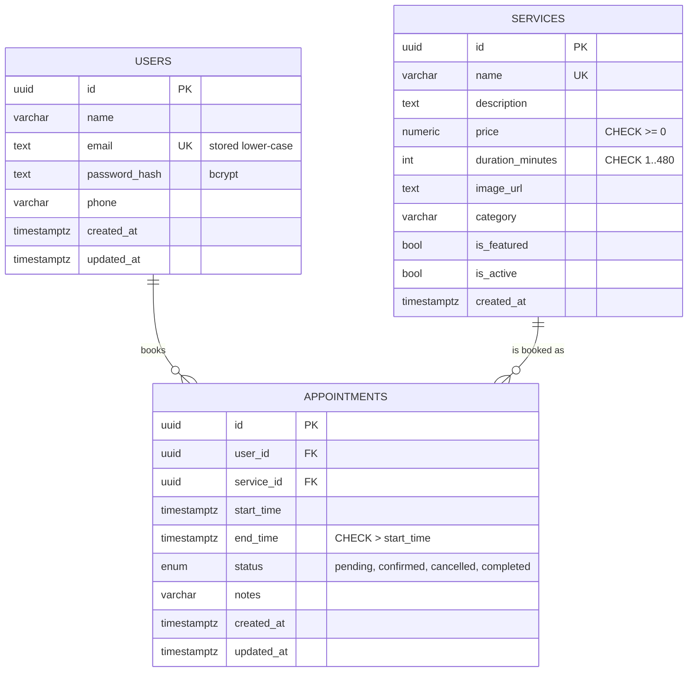

# Seba (সেবা) Backend

REST API for **Seba**, a service booking and management app: customers browse services, book appointments, manage their bookings, and ask an AI assistant (English, Bangla or Banglish) for recommendations.

- **Roles:** customer and admin accounts, with admin tools for services (dynamic form), payments, discounts, bookings, a dashboard and sales reports
- **Currency:** all prices are in **BDT** (Bangladeshi taka, ৳)
- **Stack:** Node.js 24, Express 5, PostgreSQL 16, Prisma 7, JWT, Zod, Gemini
- **Interactive API docs (Swagger UI):** `http://localhost:3000/api/docs` (spec: [`docs/openapi.yaml`](docs/openapi.yaml))
- **Live API (Render + Neon):** https://seba-api-0062.onrender.com (Swagger: https://seba-api-0062.onrender.com/api/docs). Free tier: the first request after idle can take 30-60 s.
- **Flutter app:** see the `service-booking-app` repository

## Quick start (Docker)

Requires Docker Desktop. Nothing else needs to be installed.

```bash
cp .env.example .env          # then edit values if you like (see below)
docker compose up -d --build  # starts PostgreSQL + the API
```

On start the API container applies the database migrations, seeds demo data, and runs on **http://localhost:3000**.

| | |
|---|---|
| Health check | http://localhost:3000/api/v1/health |
| Swagger UI | http://localhost:3000/api/docs |
| Demo customer | `demo@example.com` / `Demo@1234` |
| Demo admin | `admin@example.com` / `Admin@1234` (role `admin`; public sign-up only ever creates customers) |
| Admin key (local) | `dev-admin-key-change-me` (header `X-Admin-Key`) |

Code changes: Docker Desktop on Windows doesn't forward file-change events, so run `docker compose restart api` after editing `src/`. After changing `package.json` or the Prisma schema, run `docker compose up -d --build api`.

Reset the database completely: `docker compose down -v && docker compose up -d --build`.

## Configuration

All settings are environment variables, validated at startup (the app refuses to boot with a bad config). See [`.env.example`](.env.example).

| Variable | Purpose |
|---|---|
| `DATABASE_URL` / `DATABASE_SSL` | PostgreSQL connection. Set `DATABASE_SSL=true` for Neon. |
| `JWT_SECRET` | Signing secret, at least 32 characters. |
| `JWT_EXPIRES_IN` | Token lifetime (default `7d`). |
| `ADMIN_API_KEY` | Key for the admin status endpoint (at least 16 characters). |
| `BUSINESS_TZ` | IANA time zone for working hours and slot labels (default `UTC`; this project uses `Asia/Dhaka`, Bangladesh time, UTC+6). |
| `CORS_ORIGINS` | Comma-separated allowed origins, or `*`. |
| `GEMINI_API_KEY` | Google AI Studio key. **Stays on the server only.** Empty disables the assistant. |
| `GEMINI_MODEL`, `GEMINI_FALLBACK_MODEL` | Primary and fallback model (fallback is tried once on overload, rate limit or timeout). |
| `PUBLIC_API_URL` | This API's public URL. Payment gateways send the customer's browser back to it. |
| `SSLCOMMERZ_STORE_ID`, `SSLCOMMERZ_STORE_PASSWORD`, `SSLCOMMERZ_SANDBOX` | SSLCommerz (cards, bKash, Nagad, Rocket). Optional; the option is offered only when set. |
| `AAMARPAY_STORE_ID`, `AAMARPAY_SIGNATURE_KEY`, `AAMARPAY_SANDBOX` | aamarPay. Optional, same rule. |
| `GATEWAY_MOCK_ENABLED` | Built-in pretend checkout for demos and tests (default on outside production). |

## Tests

Integration tests run against the local PostgreSQL (they create and delete their own `test-*` users).

```bash
docker compose up -d db
npm install
npm test
```

They cover auth, profile, catalog filters, slot generation, booking conflicts (including a concurrent double-booking race), cancel rules, ownership checks, admin transitions and AI endpoint validation. Gemini is never called in tests.

## Database



Schema: [`prisma/schema.prisma`](prisma/schema.prisma). Migration: [`prisma/migrations/`](prisma/migrations/). Prisma cannot express the CHECK constraints or the exclusion constraints below, so they are hand-written SQL at the end of the init migration.

### Preventing conflicting bookings

Two PostgreSQL exclusion constraints (using `btree_gist`) are the source of truth:

- `appointments_no_service_overlap`: no two **active** (`pending` / `confirmed`) appointments for the same service may overlap in time.
- `appointments_no_user_overlap`: one user cannot hold two overlapping active appointments.

Cancelled and completed appointments are ignored, so cancelling frees the slot. Because the database enforces this, simultaneous requests cannot double-book: one succeeds (`201`) and the other gets `409 SLOT_UNAVAILABLE`. The availability endpoint is advisory only, for the UI.

### Booking rules

Configurable in [`src/config/constants.js`](src/config/constants.js): working hours 09:00-17:00 in `BUSINESS_TZ`, 30-minute slot grid, a slot must end before closing, minimum 60 minutes' notice, up to 60 days ahead. A service has one provider (capacity 1).

Statuses: `pending` (new) → `confirmed` → `completed`, or `cancelled`. Users can cancel only `pending` bookings. Confirming/completing is done through the admin-key endpoint (no admin UI is in scope):

```bash
curl -X PATCH http://localhost:3000/api/v1/admin/appointments/<id>/status \
  -H "X-Admin-Key: dev-admin-key-change-me" -H "Content-Type: application/json" \
  -d '{"status":"confirmed"}'
```

A background job also marks confirmed appointments as `completed` once their end time has passed.

## AI assistant

`POST /api/v1/ai/chat` (authenticated): the assistant answers questions about the services and recommends up to three, returning their ids so the app can show tappable cards.

- **Languages:** it detects whether the latest message is **English**, **Bangla** (বাংলা script) or **Banglish** (Bangla in Latin letters) and replies in the same one. The response includes `language` (`en`, `bn`, `banglish`).
- **Grounded:** the current service catalog is injected into every request, so it cannot invent services or prices. Returned ids are validated against the database.
- **Safe:** the API key lives only on the server. Input is limited (500 characters, 10 history messages), requests are rate-limited per user (10/min), off-topic and prompt-injection attempts are declined.
- **Resilient:** 20 s timeout, one retry on a fallback model, and a clear `503 AI_UNAVAILABLE` if both fail.

## Admin, payments, discounts and notifications

Two kinds of accounts: **customers** and **admins** (`role` on the user; public sign-up only ever creates customers, the demo admin is seeded). Everything under `/api/v1/admin` needs an admin's JWT; the role is read from the database on every request. Full details and examples are in Swagger.

| Area | What it does |
|---|---|
| **Services (dynamic form)** | Admins add, edit and hide services. The form is dynamic: admins can define **custom fields** (text, long text, number, yes/no, dropdown; required or optional) with `/admin/service-fields`, and each service stores values for them in `attributes`. The API validates the values against the field definitions; customers see the filled values on the service page. |
| **Payment options** | Admins manage the payment methods customers can choose when booking: cash, card, bKash, Nagad, bank and so on (`/admin/payment-methods`). Wallet-style methods ask for the customer's transaction ID, and an admin verifies it (`PATCH /admin/appointments/{id}/payment`). Manual methods move no money through this server. |
| **Online payments (SSLCommerz / aamarPay)** | `POST /appointments/{id}/pay-online` creates a hosted checkout for the booking's **exact price** (after any discount) and returns the link. The customer pays on the gateway's page; the gateway then calls back (`/payments/gateway/{provider}/{success,fail,cancel,ipn}`) and the server **asks the gateway to confirm** the transaction and checks the amount before marking the booking paid, so a browser claiming "success" is never trusted. Each attempt is a row in `payment_sessions`. The AI assistant can send the same link in chat (intent `pay_booking`): the server picks the customer's nearest unpaid booking and writes the amount itself, the model never does. A gateway is offered only when its keys are set; a built-in demo checkout is available for demos and tests. |
| **Discounts** | If a customer asks the AI assistant for a discount, the assistant never grants one. It first asks **which exact service** the discount is for (it never guesses), then files a request, tells the customer (in English, Bangla or Banglish) that an admin is reviewing it, and waits. An admin approves (percent up to 90%, or a fixed BDT amount, with an expiry) or declines, and the assistant answers the customer in their language (Gemini, with template fallback). An approved discount belongs to **that customer only** and is used by **one order**; it is applied automatically to their next booking and then consumed, so later orders pay the current price. Cancelling that booking gives it back until it expires. |
| **Bookings** | Admins see all bookings, filter them, and confirm / complete / cancel them. Each booking stores a **price snapshot** (list price, discount, amount to pay), so later price edits never rewrite past sales. |
| **Dashboard and reports** | `GET /admin/dashboard` (totals, sales today / this month / all time, pending pipeline, bookings by status, top services, last 14 days, latest bookings) and `GET /admin/reports/sales` (date range grouped by day, service, category or payment method, with CSV export). **Sales = price paid for bookings that are confirmed or completed**, dated by the service date in `BUSINESS_TZ`. |
| **Notifications** | In-app notifications for booking events, payment verification and discount decisions (customers), and new bookings, cancellations and discount requests (admins): `/notifications`, `/notifications/unread-count`, mark read / read all. |

## Security

bcrypt password hashing, JWT (HS256) with expiry, constant-time-style login errors, helmet, restricted CORS, global and per-route rate limits (stricter on auth and AI), Zod validation on every input, owner-scoped queries (other users' data returns `404`), secrets only in environment variables.

## Deploy (Render + Neon)

The same `Dockerfile` runs locally and on Render.

1. **Neon:** create a project (same region as Render, e.g. Singapore). From **Connect**, copy the **direct** connection string (pooling off, no `-pooler` in the host). The image runs `prisma migrate deploy` on start, which needs a session-level connection, so use the direct string for the app too. Traffic here is small, so pooling isn't needed.
2. **Render:** New Web Service → this repo → **Docker**, region Singapore, free instance. Set the variables from [`.env.production.example`](.env.production.example): `NODE_ENV=production`, `DATABASE_URL`, `DATABASE_SSL=true`, `JWT_SECRET`, `ADMIN_API_KEY`, `GEMINI_API_KEY`, `GEMINI_MODEL`, `GEMINI_FALLBACK_MODEL`, `CORS_ORIGINS`, `BUSINESS_TZ`.
3. Set the health check path to `/api/v1/health`.
4. Migrations run automatically on every start (a no-op when up to date).
5. Seed once from your machine. The seed only creates what is missing, so edits made by an admin are never overwritten. Add `SEED_FORCE=true` to deliberately reset the demo services (prices, photos) to the values in `prisma/seed.js`:
   ```bash
   DATABASE_URL="<direct url>" DATABASE_SSL=true node --env-file=.env prisma/seed.js
   ```

Free-tier note: Render sleeps after inactivity and Neon autosuspends, so the first request after idle can take 30-60 s.

## Project structure

```
prisma/            schema, migrations, seed
src/
  config/          env validation, booking constants
  db/              Prisma client + driver adapter
  middleware/      auth, validation, rate limits, error handling
  modules/         auth, users, services, appointments (slots + booking), admin, ai
  jobs/            completion job
  docs/            Swagger UI wiring
  utils/           ApiError, response helpers, timezone helpers
docs/openapi.yaml  OpenAPI 3 spec
tests/             vitest + supertest integration tests
```
